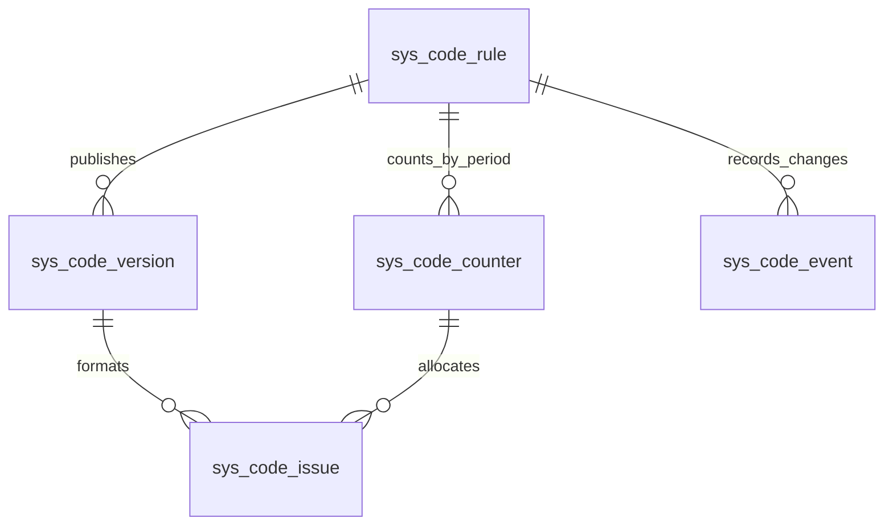

# 编码规则数据库与发号事务

本文落实[需求与业务设计](code%20system%20业务设计.md)中的三条约束：同一对象只签发一次、规则内最终编码唯一、规则改版后可以还原历史。以下为 Business 的 EF Core 映射，增量迁移为 `20261110143134_CodeSystem`。

## 1. 归属与关系

编码系统归属 Business 服务，五张业务表由 `BusinessDbContext` 及其 SQL Server 迁移管理，统一使用 `sys_code_` 前缀和单数表名。Business 的 Domain 层定义规则、渲染约束和原子签发抽象，Application 层校验权限并编排业务提交，Infrastructure 层实现事务、约束和分页，Api 层暴露版本化管理契约。角色归属独立的 Application 身份服务，Business 通过版本化身份契约核对角色，在签发流水中只保存经办人的稳定用户 ID。参见[认证与业务分离部署](../../../认证与业务分离部署.md)。



下表采用 SQL Server 类型。未标注“可空”的列均必填。实体 ID 使用服务端生成的 GUID，时间以 UTC 写入 `datetime2(7)`。业务键、期间键和生成码统一以限定 ASCII 字符写入，采用逐字节比较的排序规则。所有外键均限制删除。规则通过停用退出使用，唯一索引覆盖全部历史行。计数器、版本、流水与审计记录没有业务删除入口。

### 1.1 规则主表 `sys_code_rule`

| 列 | 类型 | 含义与约束 |
| --- | --- | --- |
| `id` | uniqueidentifier | 主键 |
| `rule_key`、`module_key` | varchar(64) 各一列 | 规则键、归属模块，创建后固定。全局唯一索引 `(rule_key)` |
| `name` | nvarchar(100) | 业务名称，去除首尾空白后 1–100 字 |
| `status` | varchar(16) | 检查约束，限 `unpublished`、`enabled`、`disabled` |
| `active_version_no` | int，可空 | 未发布时为空，启用或停用时必填。复合外键 `(id, active_version_no)` 指向本规则版本 |
| `draft_json` | nvarchar(max)，可空 | 当前唯一草稿，非空时须为合法 JSON。已发布且无待发布修改时为空 |
| `revision` | bigint | 初值 1，管理写操作成功时加一；用作 EF 并发令牌 |
| `created_at_utc`、`updated_at_utc` | datetime2(7) | 创建与最后一次管理变更时刻 |
| `created_by`、`updated_by` | uniqueidentifier | 手工操作记录管理人 ID，清单初始化使用固定的 `CodeStartup.SeedActor` 审计标识 |

列表索引 `(module_key, status, updated_at_utc, id)`。计数推进不更新规则修订号。建表时先建规则，再建版本，最后补当前版本外键。创建规则时当前版本为空，发布事务先插版本再更新指针。

### 1.2 不可变版本 `sys_code_version`

| 列 | 类型 | 含义与约束 |
| --- | --- | --- |
| `rule_id`、`version_no` | uniqueidentifier、int | 复合主键，规则外键，版本号从 1 递增 |
| `definition_json` | nvarchar(max) | 经校验的完整快照，含格式版本、时区、周期、起值、步长和全部有序段；检查 JSON 有效 |
| `published_at_utc`、`published_by` | datetime2(7)、uniqueidentifier | 发布时刻、发布人 |
| `reason` | nvarchar(256) | 发布原因，去除首尾空白后 1–256 字 |

段始终随整份定义校验、发布、读取，以 JSON 数组保留顺序。已签发编码同时保存最终文本，读取历史记录时直接返回签发值。定义解析器按 `schemaVersion` 读取旧快照。

下例是入库单的完整草稿，也是发布后版本 1 的快照格式。

```json
{
  "schemaVersion": 1,
  "utcOffset": "+08:00",
  "reset": "day",
  "start": 1,
  "step": 1,
  "segments": [
    { "type": "literal", "text": "RK-" },
    { "type": "year" },
    { "type": "month" },
    { "type": "day" },
    { "type": "literal", "text": "-" },
    { "type": "sequence", "width": 4 },
    { "type": "literal", "text": "-A" }
  ]
}
```

### 1.3 期间计数器 `sys_code_counter`

| 列 | 类型 | 含义与约束 |
| --- | --- | --- |
| `rule_id`、`period_key` | uniqueidentifier、varchar(8) | 复合主键，规则外键。期间键仅取 `ALL`、四位年、六位年月或八位年月日 |
| `last_value` | bigint | 本期间最近成功签发的数值，检查范围 1–999999999999 |
| `updated_at_utc` | datetime2(7) | 最近签发时刻 |

第一笔签发时直接写起值。事务回滚时撤销该行的插入或更新。主键中不含版本号，故换模板、扩位、停用和恢复均不会重开同期间计数器。

### 1.4 签发流水 `sys_code_issue`

| 列 | 类型 | 含义与约束 |
| --- | --- | --- |
| `id` | uniqueidentifier | 签发 ID，主键 |
| `rule_id`、`version_no` | uniqueidentifier、int | 复合外键指向签发时版本 |
| `period_key`、`sequence_value` | varchar(8)、bigint | 与 `rule_id` 组成计数器外键 `(rule_id, period_key)`；流水数值范围同计数器 |
| `code` | varchar(64) | 已渲染的完整非空文本 |
| `request_id`、`business_id` | uniqueidentifier 各一列 | 业务方持久化的请求 ID、业务对象 ID，均禁止空 GUID。草稿态对象也须先取得稳定 ID |
| `issued_by` | uniqueidentifier | 首次成功签发时的经办人 ID，由 Business 从已验证的用户上下文取得，重放保留原值 |
| `issued_at_utc` | datetime2(7) | 本次签发选定的 UTC 时刻 |

| 唯一键 | 保护的业务约束 |
| --- | --- |
| `(rule_id, request_id)` | 重送请求最多落一笔 |
| `(rule_id, business_id)` | 同一对象即使换请求 ID 也不能得到第二个号 |
| `(rule_id, period_key, sequence_value)` | 同期间不同版本也不能重复使用数值 |
| `(rule_id, code)` | 即使改版后碰巧拼出了历史文本也不能签发 |

另建索引 `(rule_id, issued_at_utc, id)` 供审计列表按时间翻页。签发行只追加。业务模块保存本地对象与签发 ID 的绑定，并对其业务唯一列建对应唯一约束。

### 1.5 配置审计 `sys_code_event`

| 列 | 类型 | 含义与约束 |
| --- | --- | --- |
| `id`、`rule_id` | uniqueidentifier 各一列 | 主键、规则外键 |
| `action` | varchar(16) | 枚举 `create`、`save_draft`、`publish`、`disable`、`enable` |
| `revision` | bigint | 操作成功后的规则修订号，唯一键 `(rule_id, revision)` |
| `version_no` | int，可空 | 操作后生效的版本，未首发时为空；与规则 ID 共同引用版本 |
| `actor_id`、`occurred_at_utc` | uniqueidentifier、datetime2(7) | 操作人和操作时刻 |
| `reason` | nvarchar(256)，可空 | 发布、停用、恢复必填，其余动作可空 |

配置与事件同事务提交。按 `(rule_id, occurred_at_utc, id)` 查询事件。可通过相邻已发布快照复核定义差异；草稿保存事件只记录编辑人、时刻和修订号。

## 2. 正式取号的事务边界

同一规则的正式签发和所有管理写操作都先锁同一规则主键行，再按固定顺序访问子表。SQL Server 可在短事务内通过主键索引读取父行并持有更新锁至提交，例如 `WITH (UPDLOCK, HOLDLOCK)`。所有实例遵循同一协议。不同规则可独立推进；热门规则内会串行，事务中只做本地数据库操作和确定性渲染。首版不预分配号段。

1. **鉴权与定位。** Business 校验当前经办人对具体单据的提交权限，按业务动作映射取得规则键，从已持久化的单据请求取得非空请求 ID 和对象 ID。权限校验也覆盖重放路径。进入事务锁定归属范围内的规则行。
2. **先判重。** 按规则和请求 ID 查流水。对象 ID 相同则返回原流水。对象不同则返回 `idempotency_conflict`。若请求 ID 未使用但对象已有流水，返回 `business_already_numbered`，由单据提交逻辑用原请求记录恢复。判重早于规则状态检查、版本选择与取时。
3. **选版本与期间。** 新请求必须命中已启用规则。读当前版本，锁内取一次权威 UTC 时刻（SQL Server 使用数据库 UTC 时钟），按固定偏移同时计算期间键及所有日期段。跨日时已提交过的旧期间计数器仍保留。
4. **取数与渲染。** 读 `(rule_id, period_key)`，不存在时取 `start`，否则取 `last_value + step`。超过 `10^width - 1` 返回 `sequence_exhausted`。按段顺序渲染，以同一事务插入或推进计数器并插入签发流水。
5. **提交后返回。** 任一步失败都回滚本次写入。最终文本撞到历史唯一键时返回 `code_collision`，由维护员变更模板消除冲突再重试。遇到死锁等瞬态冲突时，用原键做有界整笔重试；提交结果不明时先按原键复查，仍无法确认则返回可重试错误。断网重发遵循同一流程。

发布、停用和恢复持同一父行锁，检查 `expectedRevision`，再校验状态转换、写版本或状态并追加审计。先持锁的取号按旧状态完成；随后获得锁的请求读到新状态。创建规则时依赖全局唯一规则键处理并发创建。缓存可用于展示，正式签发始终在事务中读取有效状态与版本。

未来通过内部 HTTP 接入 FileStorage 时，第 1 步的文件操作权限由 FileStorage 校验，Business 校验发起服务的规则范围和经办人身份。第 2 至 5 步仍使用同一套 Business 事务。FileStorage 保存取号请求、签发 ID 和业务编码，通过原请求重试完成本地绑定，两边数据库事务独立提交。

## 3. 失败恢复、迁移与核对

| 情形 | 恢复或核对方式 |
| --- | --- |
| 提交前进程退出 | 数据库回滚计数器与流水；相同请求可重试 |
| 已签发，单据绑定未完成 | 单据提交逻辑读取待完成记录，用相同两项 ID 重放并绑定。单据已取消时记录该事实，号码保留 |
| 数值达到位宽上限 | 审核后发布更宽模板，或等待自然进入下个重置期间；继续使用原请求 |
| 发现模板碰撞 | 依据规则、期间和版本核对已发文本，发布带可区分前缀的兼容版本。禁止推进计数器试撞或手工调小计数器 |
| 数据恢复与对账 | 同一还原点恢复五张表并暂停新签发。逐期间核对 `last_value = MAX(sequence_value)`、有效版本、唯一键以及单据上绑定的签发记录。若单据保留了还原点之后的号码，须先从可验证记录恢复这些签发和计数，再开放取号 |

部署时先执行 Business 增量迁移，建立五张表、外键及唯一索引，再开放管理入口；首个业务模块完成存量检查后单独启用规则。停用入口或回滚应用时保留已经签发的数据。发布前使用隔离 SQL Server 验证首次建桶、同规则并发、跨实例重试、发布竞争及异常回滚，详见[接口与验收](接口与验收.md)。

## 4. 启动初始化的落库边界

### 部署顺序

1. 使用部署环境的数据库配置，先应用迁移。从 `server` 目录执行下列命令。已有部署由 EF 迁移历史判断待执行项；全新安装还须按平台部署说明初始化 Application 身份库。

   ```powershell
   dotnet ef database update --project src/Business/Devkit.Business.Infrastructure --startup-project src/Business/Devkit.Business.Api --context BusinessDbContext
   ```

2. 在 Application 和 Business 各自的外部配置文件登记模块、场景，然后启动 Application、Business 并发布 Web。网关将管理路径转发 Business，角色初始化走 Business 到 Application 的内部连接。
3. Application 启动时自动补齐编码规则菜单。刷新导航后，按模块授予权限。以 `wms` 为例，授予 `code.scope.wms.edit` 后可以维护 WMS 草稿。发布和全模块审计分别授予 `code.scope.wms.publish`、`code.scope.wms.audit`。配置中去掉场景会将其从可选目录移除，停用已发布规则请使用停用操作。

### 配置示例

下例为 Business 的外部 JSON。开发配置已登记 `wms.receipt`、`wms.batch`、`master.material`；生产配置的场景、角色键和初始草稿清单默认均为空。按需将下例写入部署配置即可让初始化器补建一份未发布草稿。

```json
{
  "CodeSystem": {
    "Scenarios": [
      { "RuleKey": "wms.receipt", "ModuleKey": "wms", "ObjectType": "入库单" }
    ],
    "RoleKeys": ["wms-code-editor"],
    "Drafts": [{
      "RuleKey": "wms.receipt",
      "Name": "入库单号",
      "Definition": {
        "SchemaVersion": 1, "UtcOffset": "+08:00", "Reset": "none", "Start": 1, "Step": 1,
        "Segments": [{ "Type": "literal", "Text": "RK-" }, { "Type": "sequence", "Width": 4 }]
      }
    }]
  }
}
```

Application 的对应配置如下。每个部署角色使用一个固定 ID，名称或初始权限由身份服务的清单决定。Business 请求只提供角色键。启用角色初始化时，两端从部署机密注入相同的 `CodeSystem__BootstrapKey`（至少 32 个字符），跨主机使用 HTTPS。无需预置角色时让 Business 的 `RoleKeys` 保持空数组，启动时跳过该调用。

```json
{
  "CodeSystem": {
    "Modules": ["wms"],
    "Roles": [{
      "Key": "wms-code-editor", "Id": "1d6ecf18-9898-47b8-a228-8519f3e04609",
      "Name": "WMS 编码维护员", "Permissions": ["code.scope.wms.edit"]
    }]
  }
}
```

### 幂等与故障处理

Business 通过公共扩展 `AddStartupDataInitializer<CodeStartup>()` 注册编码系统初始化器，实现 `IStartupDataInitializer.InitializeAsync`。宿主每次启动在独立的 `BackgroundService` 和依赖注入作用域内执行一次。角色、基础数据两个步骤由同一初始化器顺序等待，贯穿使用宿主取消令牌。数据库结构由迁移建立。

1. **角色步骤。** 有角色清单时，由 Business 通过限定在编码系统清单内的版本化内部契约触发核对，使用 Application 的 `PUT /api/v1/internal/code-system/bootstrap/roles/{key}`。Application 侧持有允许创建的角色定义与初始权限，按其唯一键在本地事务内补建。遇到已有或被管理员停用的角色，保留现状。普通用户分配、恢复已撤销的权限都不属于补建。空清单直接进入下一步。
2. **基础数据步骤。** 按已登记顺序处理 Business 自有数据。每项依据稳定业务键及数据库唯一约束创建缺项，已有项保持原值。两个实例同时插入时，发生唯一键冲突的一方重新读取并核对同一项。当前未指定必须预置的生产场景或规则，保留该步骤供后续逐项登记。运行中的版本、计数器、流水均由原业务事务维护。
3. **部分成功与重启。** 每项在所属服务内提交，跨服务操作不共用事务。后台日志记录正在核对的角色键和草稿键，业务侧新建草稿时追加原因是“启动初始化”的创建事件。失败应记录并传回宿主后台异常策略。下次启动从清单开头复查，保留已成功项，继续补齐缺项。空清单完成本轮检查，后续版本新增的条目仍会执行。
