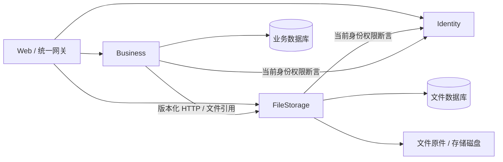

# 文件服务独立部署

FileStorage 是独立的核心上下文，源码位于 `server/src/FileStorage`，包含 Api、Infrastructure、Application、Domain 四个项目。复用 `src/Commons` 的技术能力，生产项目不引用 Business 或 Identity 的程序集。其职责是保存文件原件、元数据、引用、存储位置、迁移与清理任务；文档解析、知识库、Qdrant、模型和考试仍属于 Business。

## 服务边界

| 服务 | 数据库连接键 | 本机 F5 | Compose 宿主端口 | 镜像 |
| --- | --- | --- | --- | --- |
| Identity | `ConnectionStrings:Devkit` | 12512 | 8082 | `devkit-identity` |
| FileStorage | `ConnectionStrings:Devkit` | 12513 | 8083 | `devkit-filestorage` |
| Business | `ConnectionStrings:Devkit` | 12511 | 8080 | `devkit-business` |



FileStorage 拥有 `StoredFiles`、`FileReferences`、`StorageLocations`、`FileMigrationItems` 和 `StorageJobs`。Business 只保留稳定的 FileId 和本地引用补偿记录，不读文件数据库或磁盘，也不持有文件实体。后台解析通过 HTTP 获取带引用约束的原件，并在配置的大小上限内生成可定位的文档流。

新增文件用途通过 `FileStorage:Purposes` 配置上传/下载权限、扩展名及文档签名检查，`FileStorage:Clients` 将内部客户端限定到一个已注册用途。默认保留 `general` 和 `exam-study`，后续业务模块不需要将自身实体或解析逻辑加入文件服务。

## HTTP 契约

原有文件与存储路径、响应信封和下载行为保持兼容，宿主迁到 FileStorage：

- `/api/v1/files`：上传、列表、下载、引用查询、管理员永久删除。
- `/api/v1/storage/locations`：存储位置管理。
- `/api/v1/storage/migrations`：创建迁移；`/{id}/cleanup` 单独清理旧副本。
- **存储任务的新地址**：`GET /api/v1/storage/jobs`、`POST /api/v1/storage/jobs/{id}/retry`。不再通过备考任务接口读取或重试存储任务。

公开接口使用 Identity 签发的 RS256 JWT，FileStorage 只持公钥。每个请求独立向 Identity 确认当前权限和撤销状态，再检查功能权限、文件所有者或引用所有者。Identity 不可用时返回 503 `identity_unavailable`；无权限或无权访问仍返回 403/404。

内部 HTTP 契约位于 FileStorage 的 OpenAPI 中：

| 路径 | 凭据 | 约束 |
| --- | --- | --- |
| `PUT /api/v1/internal/files/{id}/references/{entityId}` | 用户 Bearer + `X-File-Service` + `X-File-Key` | 校验当前用户、上传用途、文件和引用所有者；同一个引用可重复提交 |
| `GET /api/v1/internal/files/{id}/content?entityId=...` | 服务凭据 | 必须存在当前客户端模块的持久化文件引用 |
| `DELETE /api/v1/internal/files/references/{entityId}` | 服务凭据 | 幂等解除当前客户端模块的引用，不能解除其他模块引用 |

内部凭据不是用户权限替代物：创建引用同时要求有效用户身份；后台读取仅限已经建立的模块引用。网关不代理内部路径，服务之间直接调用；跨主机使用 HTTPS。密钥仅通过用户机密、外部配置或环境变量注入，不保存用户 access token 到数据库。

## 引用一致性和故障恢复

跨服务不再使用一个数据库事务同时写来源和文件引用。创建文件来源时，Business 在独立本地提交中先保存补偿意图，再创建远程引用，最后用业务事务保存来源版本和解析任务。这样在业务提交前文件已经受引用保护。

若业务保存失败，先确认来源版本未提交，再尝试解除远程引用。若数据库无法确认提交结果或文件服务不可用，保留引用与补偿记录，避免错误释放仍在使用的文件。进程在中途退出后，后台在 24 小时宽限期后核对来源版本：已存在则保留引用，不存在则幂等解除引用。成功提交后的补偿清理也可由这一恢复流程完成。

删除来源时，归档来源与解除引用的 outbox 在同一个业务事务提交；提交后尝试立即解除，失败则由后台重试。恢复前残留引用继续阻止永久删除。该设计采用可恢复的最终一致性，宽限期内可能暂时多保留引用。

文件服务故障时，新增文件来源返回 503 `file_service_unavailable`，不会误报登录失效；普通业务操作和用户会话仍有效。需要读取原件的任务失败后可重试。文件自身的复制校验、读取位置切换、清理和租约恢复由 FileStorage 的后台任务独立处理。

## Visual Studio 配置

打开 `server/Devkit.Server.slnx`，将三个 API 设置为多个启动项目。FileStorage 已有 Project launch profile，访问 `http://localhost:12513/swagger`。

在 FileStorage 的用户机密中设置：

- `ConnectionStrings:Devkit`：在统一数据库文件中配置共享的 `Devkit` 数据库连接，入口为 `server/database.json` / `DEVKIT_DATABASE_CONFIG_FILE`，见 [数据库与认证](数据库与认证.md)。
- `Jwt:ValidationPublicKeyPath`：与 Identity 私钥配对的公钥，可以与 Business 使用相同公钥。
- `FileStorage:DataRoot`：文件服务器上的绝对数据目录。
- `FileStorage:Clients:Business:ApiKey`：至少 32 UTF-8 字节的随机服务密钥。

Business 设置相同的 `FileService:ApiKey`；开发默认连接 `http://localhost:12513`，生产默认要求 HTTPS。可在 PowerShell 内生成并设置同一密钥，勿提交本机机密：

```powershell
$fileServiceKey = [Convert]::ToBase64String([Security.Cryptography.RandomNumberGenerator]::GetBytes(32))
dotnet user-secrets set 'FileStorage:Clients:Business:ApiKey' $fileServiceKey --project server/src/FileStorage/Devkit.FileStorage.Api
dotnet user-secrets set 'FileService:ApiKey' $fileServiceKey --project server/src/Business/Devkit.Business.Api
./server/scripts/Update-Database.ps1 -Context FileStorage
./server/scripts/Update-Database.ps1 -Context Business
```

外部文件入口为 `DEVKIT_FILESTORAGE_CONFIG_FILE`，示例为 `server/deploy/file-storage.example.json`。`Start-FileServer.ps1` 首次生成仓库外的文件服务配置示例；补齐密钥路径、服务密钥和数据库配置后运行。`workspace.example.json` 仅保留模型与 Qdrant 配置、文件服务连接配置，不再包含文件磁盘和上传限制。

## Web、Docker 与独立发布

Vite 仅需配置 `VITE_DEV_API_TARGET=http://localhost:8081`，所有 API 默认走同源 Nginx 网关；直连部署仍可选配 `VITE_DEV_FILE_TARGET` 或 `VITE_FILE_BASE_URL`。Nginx 将 `/api/v1/files` 和 `/api/v1/storage` 转发到 `devkit-files`，Web 的存储任务页已切换到新任务地址。

Compose 新增 `devkit-files`，独占文件数据目录挂载；Business 不再挂载文件磁盘。`.env` 使用 `DEVKIT_DATABASE_CONFIG_FILE` 指向统一数据库 JSON，并配置 `DEVKIT_FILE_SERVICE_API_KEY`、文件镜像和版本字段；旧的 `DEVKIT_FILESTORAGE_SQL_CONNECTION_STRING` 需迁移至统一文件。服务密钥必须补齐，两边配置一致；跨主机部署分别配置 HTTPS 地址。默认网关上传上限仍为 25 MiB；调整文件上传上限时也需调整网关上限。

```powershell
./server/scripts/Publish-Server.ps1 -Context FileStorage -Tag 'devkit-filestorage:0.1.0' -Version '0.1.0'
docker compose config --quiet
docker compose up -d --build devkit-files devkit-server
```

`filestorage-v*` 标签只发布文件镜像；`server-v*` 同时发布三个服务镜像。业务功能修改可单独发布 `business-v*`，稳定的文件服务无需同步重建或重启。Commons 或跨服务契约改变时，应验证受影响的服务版本兼容性。

## 历史独立文件库升级（共库部署不执行）

当前三个服务共用 `Devkit`，请按 [数据库与认证](数据库与认证.md) 完成迁移。以下离线复制仅用于历史分库部署，不适用于同一个数据库。

**本次不自动搬迁真实数据。** Business 的 `ExtractFileStorageContext` 迁移增加引用 outbox，并将文件表移出活动 EF 模型；保留数据库中的旧文件表供离线复制与回滚。历史迁移保持不变，因此新建 Business 数据库也暂时保留这些无运行时访问的旧表；待完成数据迁移后再独立安排清理。

1. 备份业务数据库和原件；停止旧 Business 和新 FileStorage。先升级业务库，创建空 FileStorage 库并应用其初始迁移。此时不要启动文件服务，防止默认存储位置播种导致目标非空。
2. 在隔离预发布环境先演练，使用 SQL Server 2022 / SQLCMD，在同一实例执行：

```powershell
sqlcmd -S localhost -E -b -i server/scripts/Split-FileStorageDatabase.sql -v BusinessDatabase="DevkitBusiness" FileStorageDatabase="DevkitFileStorage"
```

3. 脚本在事务中按顺序复制四张文件表，以及原 `WorkspaceJobs` 中的 `migrate/cleanup` 到 `StorageJobs`；保留 FileId、引用、哈希、位置、审计与任务状态。目标非空、结构缺失、唯一约束冲突都会中止并回滚，不修改源数据或迁移历史。
4. 保留原件对象键并挂载到文件服务器；核对 `StorageLocations.RootPath`。Windows 路径不能直接用于 Linux 容器，需要在停机期间显式映射到文件服务器的实际挂载路径。复制脚本不修改路径、不复制磁盘文件或 Qdrant。
5. 核对行数、SHA-256、引用与任务状态，抽样验证上传、下载、解析、迁移重试和清理，再启动 FileStorage、Business 与网关。旧存储任务由 FileStorage 接管，Business 不再执行它们。

若从更早的合并数据库升级，先按 [认证与业务分离部署](认证与业务分离部署.md) 分出 Identity 与 Business，再执行本节文件迁移。自动测试使用三个隔离 SQLite 数据库与实际宿主之间的 HTTP 边界；不能替代 SQL Server 数据迁移演练。产生新数据后，回滚必须同时考虑文件库与业务库的增量。

Desktop 本次未修改。通过统一网关的既有上传下载地址保持兼容；直连旧 Business 端口的文件请求将返回 404。若 Desktop 使用过备考任务接口查询存储任务，也需在后续明确的 Desktop 变更中接入新任务地址。
